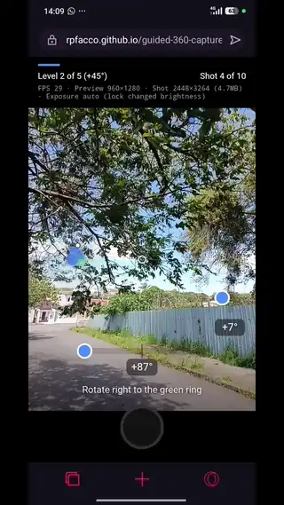

# Projeto: Aplicação com cadastro e autenticação de usuários integrando frontend, backend e persistência




## Acesso

https://rpfacco.github.io/guided-360-capture/

## Desenvolvedor(a)

Nome: Ricardo Facco Pigatto  
Curso: Sistemas de Informação


## Proposta

- Desenvolver o backend de um sistema que gera fotos panorâmicas 360° a partir das fotos tiradas pelo [app de captura guiada](https://github.com/RPFacco/guided-360-capture).
- O usuário precisa criar uma conta e fazer login. Cada usuário tem a sua própria galeria e só consegue ver as panorâmicas que ele mesmo enviou.
- Também é possível enviar o ZIP de uma captura feita anteriormente (as fotos com os dados do sensor).
- As panorâmicas prontas podem ser vistas em um visualizador 360 no próprio app, que se move pelo sensor do celular.


## Desenvolvimento

### Processo

Comecei o backend usando Python com Flask, SQLite, o schema.sql com as tabelas e as funções de conexão com o banco de dados, assim como no projeto 2. Agora, nesse projeto, eu teria que aprender como a autenticação seria encaixada, então o primeiro passo foi criar a tabela `users`, com o email único e um campo de senha em hash.

Na rota de **cadastro** aprendi que a senha nunca deve ser salva no banco do jeito que o usuário digitou. O Werkzeug, que é uma biblioteca que já vem junto com o Flask, tem a função `generate_password_hash`, que transforma a senha em um hash, e é só isso que vai para o banco. Na rota de **login** eu busco o usuário pelo email e uso o `check_password_hash` para comparar a senha digitada com o hash salvo. Se o email não existir ou a senha estiver errada, a resposta é a mesma, assim como é feito na maioria dos sites, pra não dar a dica de qual email tem conta.

Para manter o usuário logado escolhi usar token JWT. Usei a biblioteca PyJWT, que no login o backend gera um token assinado com a `SECRET_KEY`, contendo o id do usuário e a validade de 24 horas. Depois criei uma função que confere o token e a assinatura, e devolve o id do usuário. Toda rota protegida começa chamando essa função, e se ela devolver None a resposta é 401. Para testar, criei a rota `/api/me` e documentei as rotas no Swagger, onde dá para colar o token e chamar as rotas protegidas direto pelo navegador.

Cada panorâmica é salva com o `user_id` de quem enviou, e todas as consultas filtram por ele, pois, dessa maneira, mesmo que alguém descubra o id da panorâmica de outra pessoa, o backend responde que ela não existe. Um detalhe é que a `SECRET_KEY` não pode ficar no código, porque quem tiver ela consegue criar tokens falsos e entrar como qualquer usuário, por isso no servidor ela fica em uma variável de ambiente.

Para integrar com o frontend, adicionei no app de captura as telas de login, cadastro e da galeria. Quando o usuário faz login, o token é guardado no `localStorage`, e o arquivo `api.js` coloca o cabeçalho `Authorization` em todas as requisições. Se o backend responder 401, por exemplo quando o token vence, o app apaga o token e volta para a tela de login. Para testar pelo celular antes de hospedar, usei túneis do cloudflared.

A costura das fotos ficou em um script que usa o `Hugin` (software de costura de fotos para panoramas) dentro do Docker, com um worker que fica olhando o banco e processa as panorâmicas com status `pending`, mudando para `done` ou `failed`. 

Com isso, só faltou a hospedagem. Pensei em usar o Render, mas testando vi que o plano grátis tinha pouca memória e processamento para o Hugin, que demorava muito nas costuras. Então hospedei o backend em uma máquina virtual da Azure for Students, que dá 1 GB de memória e 2 núcleos de processador.

### Trechos de código

Como o token é gerado no login:
```python
token = jwt.encode(
    {
        "sub": str(user["id"]),
        "exp": datetime.now(timezone.utc) + timedelta(hours=24),
    },
    SECRET_KEY,
    algorithm="HS256",
)
```
O token guarda o id do usuário (`sub`) e a data em que vence (`exp`), e é assinado com a `SECRET_KEY`. Quem não tiver a chave não consegue criar nem alterar um token válido.

---

Função que confere o token em toda rota protegida:
```python
def current_user_id():
    header = request.headers.get("Authorization", "")
    if not header.startswith("Bearer "):
        return None

    token = header[len("Bearer "):]
    try:
        payload = jwt.decode(token, SECRET_KEY, algorithms=["HS256"])
    except jwt.InvalidTokenError:
        return None

    return int(payload["sub"])
```
O `jwt.decode` confere se o token foi assinado com a minha `SECRET_KEY` e se ainda não venceu. Se estiver tudo certo, a função devolve o id do usuário, e se não, devolve `None`.

E é assim que as rotas usam a função:
```python
user_id = current_user_id()
if user_id is None:
    return jsonify({"error": "Não autenticado"}), 401
```

---

Como cada usuário só acessa as próprias panorâmicas:
```python
panorama = conn.execute(
    "SELECT status FROM panoramas WHERE id = ? AND user_id = ?",
    (panorama_id, user_id),
).fetchone()
```
A busca filtra pelo id da panorâmica e também pelo id de quem está logado. Se a panorâmica for de outra pessoa, a consulta não acha nada e o backend responde 404.


## Tecnologias

### Linguagens e afins

- Python com Flask - **Backend**
- SQLite - **Banco de dados**
- JWT - **Autenticação**
- Hugin - **Costura das panorâmicas**
- JavaScript - **Frontend**
- Azure e GitHub Pages - **Hospedagem back e front**

### Autenticação e autorização

A autenticação é feita com token (JWT).

- **Cadastro** (`POST /api/register`): recebe email e senha. A senha precisa ter pelo menos 8 caracteres e é salva no banco como hash. Se o email já existir, a resposta é 409.
- **Login** (`POST /api/login`): busca o usuário pelo email e confere a senha. Se estiver certa, gera um JWT assinado usando a `SECRET_KEY`, contendo o id do usuário e a validade de 24 horas. Email inexistente e senha errada dão a mesma resposta (401), para não revelar quais emails têm conta.
- **Rotas protegidas**: a função `current_user_id()` lê o cabeçalho `Authorization: Bearer <token>`, confere a assinatura e a validade e devolve o id do usuário. Sem token, com token inválido ou expirado, a rota responde 401.
- **Autorização**: toda consulta de panorâmicas filtra pelo `user_id` de quem está logado. Assim, um usuário não consegue listar nem abrir a panorâmica de outro, mesmo sabendo o id dela.
- **No frontend**: o token fica salvo no `localStorage`, e o api.js coloca o cabeçalho Authorization em toda requisição. Se o backend responder 401, por exemplo com o token vencido, o app apaga o token e volta para a tela de login.

### Ambiente de desenvolvimento

- IntelliJ IDEA
- Git e GitHub
- Docker Desktop
- Cloudflared

## Referências e créditos

- https://github.com/elc1090/demo-backend-auth - Exemplos de autenticação
- [Rodrigo Appelt (Agentew04)](https://github.com/Agentew04) - Contribuição no app de captura
- https://pyjwt.readthedocs.io - Documentação do PyJWT
- https://flask-cors.readthedocs.io - Documentação do Flask-CORS
- https://wiki.panotools.org/Hugin - Documentação do Hugin
- https://azure.microsoft.com/free/students - Azure for Students
- https://youtu.be/2GGwz8zUy2M?si=3IqnNBmHpSXSxA4G - Flask setup tutorial by Noah Does Coding 
- https://werkzeug.palletsprojects.com/en/stable/utils/#module-werkzeug.security - Hash de senhas com Werkzeug
- Claude | ChatGPT - Assistente de IA

---
Projeto entregue para a disciplina de [Desenvolvimento de Software para a Web](http://github.com/andreainfufsm/elc1090-2026b) em 2026b