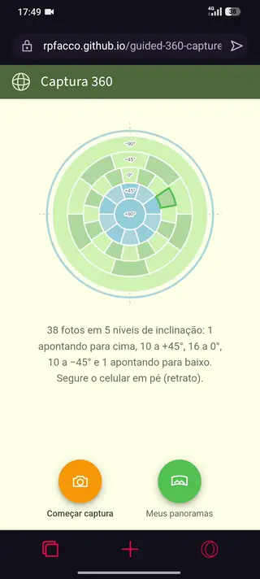

# Projeto final: Captura e costura de panorâmicas 360° com login federado e testes automatizados




## Acesso

https://rpfacco.github.io/guided-360-capture/

Documentação da API (Swagger): https://pano.rodrigoappelt.com.br/api/docs

## Desenvolvedor(a)

Nome: Ricardo Facco Pigatto  
Curso: Sistemas de Informação


## Proposta
É a continuação do projeto 3, do desenvolvimento de um sistema de captura e junção de panoramas 360. Para o projeto 4, foram feitas melhorias gerais, incluindo login federado e qualidade de software.


- **Frontend:** JavaScript, HTML, CSS, Three.js e APIs para câmera, sensores de orientação e IndexedDB para guardar fotos ao fechar o navegador.
- **Backend:** Python com Flask, banco de dados relacional (SQLite) e Hugin (costura dos panoramas).
- **Novos conceitos:** login federado (OAuth) e qualidade de software, aprofundando testes, segurança, acessibilidade, desempenho ou implantação.
- **Login federado:** além do cadastro com email e senha, agora dá para entrar com a conta Google.
- **Qualidade de software:** o backend ganhou testes automatizados com pytest, com testes de unidade da matemática da costura e testes funcionais das rotas da API.


## Desenvolvimento

### Processo

Comecei pelo login com Google, seguindo um vídeo tutorial que mostrava como adicionar autenticação com o Google e também a prática no codespaces da disciplina. No frontend coloquei o botão do Google, que devolve um token assinado pelo próprio Google, e o app manda esse token para o backend, que usa a biblioteca google-auth para conferir se ele é verdadeiro e se foi emitido para o meu app. Dessa forma, criei a tabela `google_accounts` para ligar a conta Google ao usuário, e no final o backend devolve o mesmo JWT do login com senha, então o resto do app continuou funcionando igual. Tive uma dúvida sobre o que fazer quando o email da conta Google já tem uma conta com senha, e, diante das opções de criar contas separadas ou impedir o usuário de criar contas com o mesmo email, decidi não juntar as contas, então o app pede para entrar com a senha.

Após, comecei a parte de qualidade de software e escolhi aprofundar os testes, pois o backend não tinha nenhum. Vi um vídeo sobre como testar aplicações Flask com pytest, onde aprendi a diferença entre os testes de unidade, que testam uma função sozinha, e os testes funcionais, que chamam as rotas da API como se fosse o app. Também aprendi o padrão GIVEN/WHEN/THEN, que é primeiro preparar o cenário, depois executar a ação e no final conferir o resultado com o `assert`, e isso deixou os testes bem mais fáceis de entender.

A maior dificuldade foi que o `app.py` sempre usava o banco de verdade, então os testes iam gravar usuários no `app.db`, e para resolver isso mudei os caminhos do banco para variáveis de ambiente, assim cada teste usa um banco temporário. Para o login com Google usei o `monkeypatch` do pytest, que troca a função que confere o token por uma falsa, então o teste não depende do Google.

### Trechos de código

Como o teste do login com Google funciona sem chamar o Google:
```python
def fake_google(credential, request, audience, **kwargs):
    assert credential == "credential-do-google"
    return {"sub": "google-123", "email": "Ana@Gmail.com", "email_verified": True}

monkeypatch.setattr(id_token, "verify_oauth2_token", fake_google)
```
No login de verdade, o backend manda o `credential` para o Google conferir. No teste, existe o `monkeypatch` do pytest, que basicamente troca uma função pela outra até rodar o teste, e depois desfaz a troca no final.

---

Como o teste confere que ninguém consegue falsificar um token:
```python
forged = jwt.encode(
    {"sub": "1", "exp": datetime.now(timezone.utc) + timedelta(hours=1)},
    "chave-de-quem-quer-se-passar-pela-ana",
    algorithm="HS256",
)

response = client.get("/api/me", headers={"Authorization": f"Bearer {forged}"})

assert response.status_code == 401
```
Alguém poderia ler o que tem dentro de um JWT e montar outro igual. O que impede essa falsificação é a assinatura, que só sai certa com a `SECRET_KEY` do servidor. O teste monta um token dizendo "sou o usuário 1", assinado com outra chave, e o backend recusa mesmo o usuário 1 existindo.

---

Como o teste confere que um usuário não vê a panorâmica de outro:
```python
ana_image = client.get(f"/api/panoramas/{panorama_id}/image", headers=ana)
bruno_image = client.get(f"/api/panoramas/{panorama_id}/image", headers=bruno)
bruno_gallery = client.get("/api/panoramas", headers=bruno)

assert ana_image.status_code == 409
assert bruno_image.status_code == 404
assert bruno_gallery.get_json() == []
```
A Ana envia uma captura e os dois pedem a imagem. A Ana recebe 409 (a panorâmica existe, mas ainda não está pronta) e o Bruno recebe 404, como se ela não existisse. Se tirar o `AND user_id = ?` da consulta no `app.py`, o teste falha, porque o Bruno consegue enxergar a panorâmica da Ana.


## Tecnologias

### Linguagens e afins

- Python com Flask - **Backend**
- SQLite - **Banco de dados**
- JWT - **Autenticação**
- Google Identity Services e google-auth - **Login com Google (OAuth)**
- pytest - **Testes automatizados**
- Hugin - **Costura das panorâmicas**
- JavaScript, HTML e CSS - **Frontend**
- Three.js - **Visualizador 360**
- APIs de câmera, sensores de orientação e IndexedDB - **Captura e fotos guardadas ao fechar o navegador**
- Servidor do Rodrigo Appelt e GitHub Pages - **Hospedagem back e front**

### Login com Google

- **No frontend**: o botão do Google abre a escolha da conta e devolve um `credential`, que é um token assinado pelo Google. O app manda esse credential para `POST /api/auth/google`.
- **No backend**: a função `id_token.verify_oauth2_token`, da biblioteca google-auth, confere a assinatura do Google, a validade e se o token foi emitido para o meu `GOOGLE_CLIENT_ID`. O email da conta Google precisa estar verificado.
- **Conta**: a tabela `google_accounts` liga o id da conta Google (`sub`) ao usuário. No primeiro login a conta é criada, e nos próximos o usuário é encontrado pelo `sub`. Se o email já tiver uma conta com senha, a resposta é 409 e o app pede para entrar com a senha.
- Depois disso, o backend devolve o mesmo JWT do login com senha, então o resto do app funciona igual para os dois tipos de conta.

### Testes

Os testes ficam em `backend/tests` e usam o pytest.

- **Testes de unidade** (`tests/unit`): testam funções da costura sozinhas, sem banco e sem Docker.
- **Testes funcionais** (`tests/functional`): chamam as rotas da API pelo cliente de teste do Flask. Cobrem cadastro, login, `/api/me`, token falsificado, login com Google e o isolamento entre usuários na galeria.
- Cada teste usa um banco e pastas temporárias, criados pela fixture `client` do `conftest.py`, então os testes não mexem no banco.
- Os testes seguem o padrão GIVEN/WHEN/THEN: preparar o cenário, executar a ação e conferir o resultado.

Para rodar:
```
cd backend
pip install -r requirements.txt pytest
pytest
```

### Ambiente de desenvolvimento

- IntelliJ IDEA
- Git e GitHub
- Docker Desktop
- pytest

## Referências e créditos

- https://www.youtube.com/watch?v=SwCA0K3gy90 - Vídeo tutorial: Adicionando Autenticação com o Google
- https://github.com/elc1090/demo-auth-profile - Prática no codespaces: conta com senha ou login com Google
- https://www.youtube.com/watch?v=OcD52lXq0e8&t=508s - Testing Flask Applications with pytest - Patrick Kennedy
- [Rodrigo Appelt (Agentew04)](https://github.com/Agentew04) - Servidor do backend e contribuição no app de captura
- Claude | ChatGPT - Assistente de IA


---
Projeto entregue para a disciplina de [Desenvolvimento de Software para a Web](http://github.com/andreainfufsm/elc1090-2026b) em 2026b
